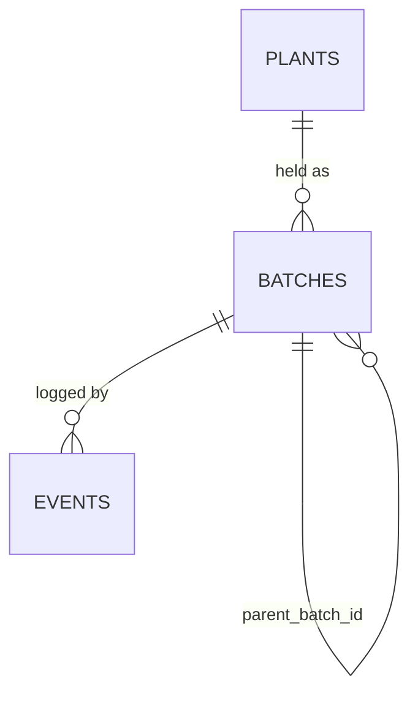

# Plant Inventory V.3 — SOP V.1

> Consolidated from [[Plant Inventory V.3 Ideas V.1]] and [[Plant Inventory V.3 Ideas V.2]].
> This is the single source of context for building the **inventory module of the SEC App**.
> Items marked **TBD** are still open (§9). Everything else is decided.

## 1. Purpose & Scope

**What it is:** an inventory management tool for SEC's plants. It records what
plants we hold, where they are, what stage they're at, how they multiply, and
how often they get contaminated.

| In scope | Out of scope |
|---|---|
| Plant records, SKUs, lab batches, collection counts | Prices, purchase costs, payments: these stay in **Zoho Books** |
| Event log (intake, subculture, stage change, count, loss) | CRM / customer records |
| Lineage, multiplication, contamination, media metrics | Export paperwork (P3 shipment / phytosanitary): parked |
| Multi-user entry + owner review | Per-vessel tracking |

**Why V.3 exists.** The V.2 Google Sheets mixed product, purchase, vessel and
event in one row. Batch IDs restarted per SKU. Lineage wasn't recorded. Land
and nursery stock (about 47 Hoya, roughly 22,400 THB spent) had no tracking at
all. And the data went from paper to a LINE photo to manual retyping, which
introduced errors.

## 2. Fixed Principles

1. **App, not spreadsheet.** V.3 is a module of the **SEC App**. No Google Forms or
   Sheets stage in between.
2. **No money in the app.** Costs live in Zoho Books. The app only stores the
   reference that links the two (§6, SOP-8).
3. **A plant record is not an SKU.** Every cultivar we hold gets a `PLT` record.
   An SKU is assigned only when the plant is promoted to Portfolio.
4. **Batch is the tracking unit**, not the vessel. Lineage comes from `parent_batch_id`.
5. **Events are append-only.** Counts and stages are calculated from events. Fix a
   mistake by adding a correcting event, never by editing history.
6. **Portfolio = intent, availability = calculated.** Nobody types "available".
7. **Enter once, in the app.** Coded fields use dropdowns, and the date and
   week are filled in automatically.

## 3. Codes & Vocabulary

**IDs** (global, sequential, never reused or restarted)

| Entity | Format | Example |
|---|---|---|
| Plant | `PLT-nnnn` | `PLT-0042` |
| SKU | `<GENUS3><nnn>` | `HYA001`, `PHL003`, `ALC015` |
| Batch | `BAT-nnnnn` (shown as `<SKU or PLT> · Bnnn`) | `BAT-00117` → `PHL001 · B003` |
| Event | `EVT-nnnnn` | `EVT-01502` |

**Plant status:** `Collection` (held, not intended for sale) → `Portfolio`
(intended to sell, has SKU) → `Retired` (no longer held). Portfolio can also go
back to Collection.

**Plant source:** `Purchase` | `Gift` | `Propagated` | `Unknown`. Only
`Purchase` needs a Zoho link. Gifts go straight into inventory with no cost
record.

**Location:** `Lab` | `Nursery` | `Land`

**Stages** (shared with [[Protocol Tracking System Plan V.1]], do not rename):

| Code | Stage | In use today |
|---|---|---|
| `P0` | Sterilization / new species introduction | ✅ |
| `P1` | Multiplication | ✅ |
| `P2` | Growth | ✅ |
| `P3` | Transport | reserved |
| `P4` | Growth maturity | reserved |
| `T1` | Digital content | reserved |
| `C0` | Clean | reserved |

Stage applies to lab batches. Collection batches at Nursery or Land can leave
it blank.

**Media codes:** `M001`–`M004`, `G001`, `G002`, `R001` (managed as a list in the app).

## 4. Data Model



| Table | Grain | Fields |
|---|---|---|
| `plants` | one per cultivar | `plt_id`, `genus`, `full_name`, `sku` (nullable, unique), `status`, `source`, `zoho_ref` (nullable), `promoted_by`, `promoted_at`, `notes` |
| `batches` | one per lab batch, or one standing batch per plant per non-lab location | `bat_id`, `plt_id`, `parent_batch_id` (nullable), `location`, `stage` (nullable), `live_count`*, `created_at`, `closed_at` |
| `events` | one per action, append-only | `evt_id`, `bat_id`, `action`, `qty_in`, `qty_out`, `qty_contaminated`, `media_code`, `stage_to`, `staff`, `occurred_at`, `week`*, `reviewed_by`, `reviewed_at`, `note` |
** Data model and relationships are not fixed yet. Pending additional research** 

\* Calculated, never typed: `live_count` is the sum of events. `week` comes
from `occurred_at`.

**Event actions:** `Intake` · `Subculture` · `StageChange` · `Count` ·
`Contamination` · `Transfer` · `Out` (sold or given away) · `Correction`

## 5. Business Rules

1. `sku` is set only when `status = Portfolio`, and it must be unique. The genus
   code must match `genus`.
2. Only the Owner can change `status` (promote, demote, retire). Each change
   stamps `promoted_by` and `promoted_at`.
3. `source = Purchase` → `zoho_ref` is required (**TBD** format, §9).
4. A lab batch created from a subculture must have a `parent_batch_id`.
5. `live_count` can never go negative. An event that would make it negative is rejected.
6. Events can't be edited or deleted. Mistakes get a `Correction` event.
7. Unreviewed events still count toward totals, but they are flagged until the
   Owner reviews them.
8. `PHL005` ("Philodendron ???") stays as a valid record until it is identified.

## 6. Procedures

**SOP-1 · Register a plant** (Staff or Owner)
1. Search existing plants first (genus + name) to avoid duplicates.
2. Create the `PLT` record: genus, full name, `source`, status `Collection`.
3. If `source = Purchase`, record the Zoho expense reference (SOP-8).
4. Create its first batch at the location where it is held, and log an `Intake` event with the quantity.

**SOP-2 · Promote to Portfolio** (Owner only, at the Owner's judgement)
1. Open the plant and choose *Promote*. The app proposes the next SKU for that genus.
2. Confirm. The app saves the SKU, `promoted_by` and `promoted_at`.

**SOP-3 · Start a lab batch (P0)** (Staff)
1. Create a batch at location `Lab`, stage `P0`, linked to the plant. Set
   `parent_batch_id` if the material comes from an existing batch.
2. Log `Intake` with the explant count and media code.

**SOP-4 · Subculture** (Staff, each session)
1. Pick the parent batch, then log a `Subculture` event (`qty_out` = units used).
2. The app creates the child batch or batches with `parent_batch_id`, the media
   code and the stage, and logs `Intake` on each child.
3. Log contamination found during the session as `Contamination` events (those
   units are removed from the batch).

**SOP-5 · Stage change / transfer** (Staff)
- Use `StageChange` (for example P1 → P2) or `Transfer` (Lab → Nursery). A
  transfer closes the units out of one batch and creates or adds to the batch at
  the destination.

**SOP-6 · Collection count** (Staff, cadence **TBD**)
- For each Collection plant at Nursery or Land, log a `Count` with the physical
  quantity. The app records the difference from the last count.

**SOP-7 · Review** (Owner, weekly)
- Open the unreviewed-events queue, check entries against lab reality, then
  mark them reviewed or add a `Correction`.

**SOP-8 · Link a purchase to Zoho Books** (Owner)
- When recording the expense in Zoho Books, include the `PLT-` ID (method
  **TBD**: reporting tag or reference text). Store the Zoho reference on the
  plant. Cost per plant is looked up in Zoho, by the Owner only.

## 7. Roles

| Action | Owner (Jade) | Staff (Gene, future hires) |
|---|:-:|:-:|
| Register plant, create batch, log events | ✅ | ✅ |
| Promote / demote / retire plant, assign SKU | ✅ | — |
| Review events, add corrections | ✅ | — |
| Edit codes (media, locations) | ✅ | — |
| See Zoho references | ✅ | — |
| View dashboards | ✅ | ✅ |

## 8. Calculated Outputs

**Availability**
```
available_to_sell = status = Portfolio
                AND live_count >= min_saleable_qty   -- TBD (§9)
                AND stage >= P4
```

**Metrics** (all come from events + lineage, so no extra data entry):
- Multiplication factor per SKU per cycle. Baseline from V.2 data: `PHL001`
  went 5 → 55 in ~4 weeks, `PHL003` went 8 → 66 in ~3 weeks.
- Contamination rate by SKU / media / staff / week
- Media effectiveness by media code (this feeds protocol trials)
- Days in stage, stage conversion, weeks-to-saleable
- Weekly lab output

## 9. Open Items (TBD)

| # | Question | Blocks |
|---|---|---|
| 1 | Where does the old `Pipeline` status go: into Collection, or a separate "Candidate" state? | Data migration |
| 2 | `min_saleable_qty`: per SKU or one global default? | Availability |
| 3 | Collection count frequency (monthly or quarterly)? | SOP-6 |
| 4 | Zoho link method: reporting tag or reference text? (The API couldn't set custom fields on expenses.) | SOP-8, rule 3 |
| 5 | Backfill the missing `PHL001/002/003` and 28/01/2026 cohort history, or start V.3 clean? | Migration |

**Migration prerequisite:** replace the `product_plants` tab with a filter on
`product_pipeline`. All other V.2 sheet cleanup is done.

## 10. Sources

- V.2 Google Sheets: Product Acquisition, Product Plants, Plant Inventory V.2 (data to migrate)
- [[Protocol Tracking System Plan V.1]]: shared stage and media vocabulary
- [[Zoho Books Automation Plan V.1]]: cost side
- [[Plants Development August 2026]]: export EPICs that will need P3/P4/T1 later
