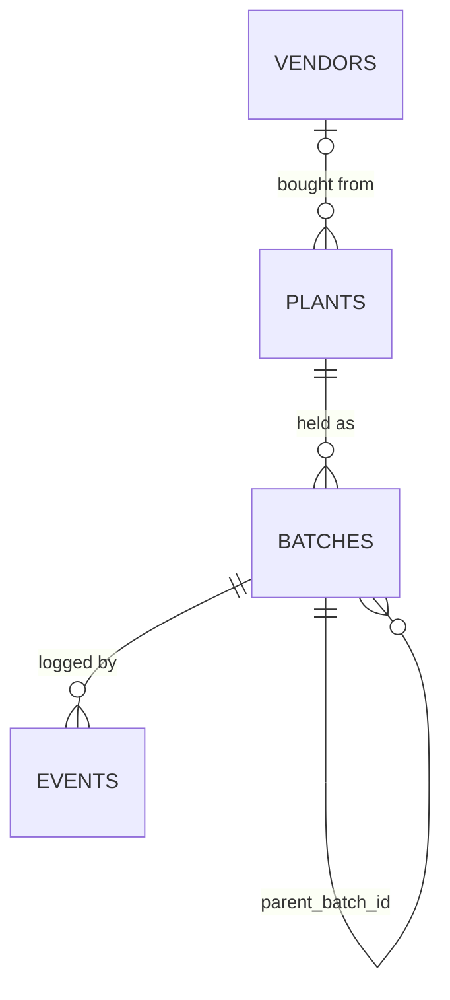

# Plant Inventory V.3 — SOP V.2

> Consolidated from [[Plant Inventory V.3 Ideas V.1]] and [[Plant Inventory V.3 Ideas V.2]].
> This is the single source of context for building **Cucumber**, SEC's standalone
> plant inventory app. Decisions behind this document are recorded in the
> [Decision Register](docs/roadmap/decisions.md) (IDs like D-07 and T-3 below).
> Nothing in this SOP is TBD. The exact database fields are finalised in roadmap
> unit U0.2 (D-05); §4 shows the agreed shape.

## 1. Purpose & Scope

**What it is:** an inventory management tool for SEC's plants. It records what
plants we hold, where they are, what stage they're at, how they multiply, and
how often they get contaminated.

| In scope | Out of scope |
|---|---|
| Plant records, SKUs, lab batches, collection counts | Prices, purchase costs, payments: these stay in **Zoho Books** |
| Event log (intake, subculture, stage change, count, loss, quarantine) | CRM / customer records |
| Lineage, multiplication, contamination, media metrics | Creating or editing vendors: **Zoho Books** owns them (Cucumber keeps a read-only copy, D-04) |
| Multi-user entry + review | Per-vessel tracking (contamination is handled by quarantine batches, D-02) |
| | Export paperwork (P3 shipment / phytosanitary): parked |

**Why V.3 exists.** The V.2 Google Sheets mixed product, purchase, vessel and
event in one row. Batch IDs restarted per SKU. Lineage wasn't recorded. Outdoor
stock at the old "Land" site (now the **Nursery** location: about 47 Hoya,
roughly 22,400 THB spent) had no tracking at all. And the data went from paper
to a LINE photo to manual retyping, which introduced errors.

## 2. Fixed Principles

1. **App, not spreadsheet.** Cucumber is a standalone web app (D-01). No Google
   Forms or Sheets stage in between.
2. **No money in the app.** Costs live in Zoho Books. The app only stores the
   reference that links the two (§6, SOP-8).
3. **A plant record is not an SKU.** Every cultivar we hold gets a `PLT` record.
   An SKU is assigned only when the plant is promoted to Portfolio.
4. **Batch is the tracking unit**, not the vessel. Lineage comes from `parent_batch_id`.
5. **Events are append-only. Nothing is hard-deleted.** Counts and stages are
   calculated from events. A mistake is fixed with a **Void** (entered in error)
   or a **Correction**, always with a reason (D-07).
6. **Portfolio = intent, availability = calculated.** Nobody types "available".
7. **Enter once, in the app.** Coded fields use dropdowns, and the date and
   week are filled in automatically.
8. **Online only.** Every site has Wi-Fi; staff phone hotspots are the backup.
   There is no offline entry (D-17).
9. **English first, Thai-ready.** All screen text is translatable so Thai can be
   added later (D-16).

## 3. Codes & Vocabulary

**IDs** (global, sequential, never reused or restarted)

| Entity | Format | Example |
|---|---|---|
| Plant | `PLT-nnnn` | `PLT-0042` |
| SKU | `<GENUS3><nnn>` | `HYA001`, `PHL003`, `ALC015` |
| Batch | `BAT-nnnnn` (shown as `<SKU or PLT> · Bnnn`) | `BAT-00117` → `PHL001 · B003` |
| Event | `EVT-nnnnn` | `EVT-01502` |

**Plant status**

| Status | Meaning |
|---|---|
| `Candidate` | Wanted, not yet held. No batches, no counts (T-1; replaces V.2 "Pipeline"). |
| `Collection` | Held, not intended for sale. |
| `Portfolio` | Intended to sell, has an SKU. Can go back to Collection. |
| `Retired` | No longer held. |
| `Voided` | Never existed (record entered in error, D-07). Kept for history, hidden from lists. |

Flow: `Candidate` → `Collection` ⇄ `Portfolio` → `Retired`. A plant can also be
registered straight into `Collection`.

**Plant source:** `Purchase` | `Gift` | `Propagated` | `Unknown`. Only
`Purchase` needs a Zoho link and a vendor (picked from the Zoho vendor list).
Gifts go straight into inventory with no cost record; who gave it goes in a
free-text source note.

**Location** (D-14)

| Location | What it covers |
|---|---|
| `Lab` | The old Lab **and** the old Nursery area (cultures and potted plants) |
| `Nursery` | The old "Land" site. "Land" is no longer a location. |

**Stages.** Owned by Cucumber (D-08). Codes can't be renamed because events
reference them. Each stage has a **sort order**, used for "stage ≥ P4"; codes
are not compared alphabetically.

| Order | Code | Stage | In use |
|:-:|---|---|---|
| 1 | `P0` | Sterilization / new species introduction | ✅ |
| 2 | `P1` | Multiplication | ✅ |
| 3 | `P2` | Growth | ✅ |
| 4 | `A1` | Acclimatization (hardening off) | ✅ new (D-06) |
| 5 | `P4` | Growth maturity: **potted plants** | ✅ (D-15) |
| — | `P3` | Transport | reserved (export) |
| — | `T1` | Digital content | reserved |
| — | `C0` | Clean | reserved |

- Lab batches **always** have a stage. Cultures grow through P0 → P1 → P2 → A1 →
  P4; purchased potted plants enter directly at P4 (D-15).
- Collection batches at the Nursery may leave stage blank.
- Each stage has a **default subculture interval** in days, used for due alerts
  (D-11). A per-protocol override can be added later (roadmap U4.2).

**Media codes:** `M001`–`M004`, `G001`, `G002`, `R001`, managed as a list in the
app. A media code names a medium recipe. Later, each code gets a versioned
recipe (U3.4), and staff can log prepared media lots made from it (U3.5).

**Reference lists** (stages, media codes, locations, genus codes) are edited by
the Admin. Items are **deactivated, never deleted**: hidden from dropdowns, still
shown on history.

## 4. Data Model



| Table | Grain | Fields |
|---|---|---|
| `plants` | one per cultivar | `plt_id`, `genus`, `full_name`, `sku` (nullable, unique), `status`, `source`, `source_note` (nullable), `vendor_id` (nullable), `zoho_ref` (nullable), `min_saleable_qty` (nullable override), `promoted_by`, `promoted_at`, `notes` |
| `batches` | one per lab batch, or one standing batch per plant per non-lab location | `bat_id`, `plt_id`, `parent_batch_id` (nullable), `location`, `stage` (nullable at Nursery only), `quarantined`, `status` (`Open` / `Closed` / `Voided`), `live_count`*, `created_at`, `closed_at` |
| `events` | one per action, append-only | `evt_id`, `bat_id`, `action`, `qty_in`, `qty_out`, `qty_contaminated`, `media_code`, `media_lot` (nullable, after U3.5), `stage_to`, `staff`, `occurred_at`, `week`*, `reason` (for Void / Correction), `voids_evt_id` (nullable), `reviewed_by`, `reviewed_at`, `note` |
| `vendors` | read-only copy of Zoho Books vendors | `zoho_contact_id`, `name`, `active`, `synced_at` |

\* Calculated, never typed: `live_count` is the sum of events. `week` comes
from `occurred_at`.

**Event actions:** `Intake` · `Subculture` · `StageChange` · `Count` ·
`Contamination` · `Quarantine` · `Release` · `Transfer` · `Out` (sold or given
away) · `Correction` · `Void`

> Field names, types and the exact shape of `Void` and `Quarantine` events are
> finalised in U0.2 (D-05). The table above is the agreed shape, not the final schema.

## 5. Business Rules

1. `sku` is set only when `status = Portfolio`, and it must be unique. The genus
   code must match `genus`.
2. Only the Admin can promote, demote or retire a plant. Each change stamps
   `promoted_by` and `promoted_at`. Moving a `Candidate` to `Collection` happens
   when its first `Intake` is logged (SOP-1).
3. A `Candidate` plant can't have batches or events.
4. `source = Purchase` → `zoho_ref` and `vendor_id` are required. Vendors come
   only from the Zoho copy; they can't be created or edited in Cucumber (D-04).
5. A lab batch created from a subculture must have a `parent_batch_id`.
6. Every `Lab` batch has a stage (D-15).
7. `live_count` can never go negative. An event that would make it negative is rejected.
8. Events can't be edited or deleted. A mistake is fixed with:
   - **Void**: the event was entered in error. Reason is required (dropdown +
     optional note). The person who logged an event can **Undo** it for
     **10 minutes** after saving; Undo creates a Void.
   - **Correction**: the event happened but a value was wrong. Reason is required.
   - A real action that was done wrongly (e.g. wrong media used) stays recorded
     and is fixed forward with new events.
9. Plants and batches are never hard-deleted. A record entered in error is
   `Voided`; one that ended normally is `Retired` (plant) or `Closed` (batch).
   The only exceptions are anonymising staff personal data on request (PDPA)
   and wiping sandbox data (D-07).
10. Unreviewed events still count toward totals, but they are flagged until
    reviewed. **Nobody reviews their own events, except the Admin** (D-03).
    Voids always go to the review queue.
11. A quarantined batch keeps its count and lineage, but it is excluded from
    availability (§8).
12. `PHL005` ("Philodendron ???") stays as a valid record until it is identified.

## 6. Procedures

**SOP-1 · Register a plant** (Tech or above)
1. Search existing plants first (genus + name) to avoid duplicates.
2. If the plant is wanted but not held yet, create it as `Candidate` and stop here.
3. Otherwise create the `PLT` record (or open the Candidate): genus, full name,
   `source`. Status becomes `Collection`.
4. If `source = Purchase`, pick the vendor from the Zoho list and record the
   Zoho expense reference (SOP-8). If `Gift`, note who gave it.
5. Create its first batch at the location where it is held, and log an `Intake`
   event with the quantity.

**SOP-2 · Promote to Portfolio** (Admin only, at the Admin's judgement)
1. Open the plant and choose *Promote*. The app proposes the next SKU for that genus.
2. Confirm. The app saves the SKU, `promoted_by` and `promoted_at`.

**SOP-3 · Start a lab batch (P0)** (Tech or above)
1. Create a batch at location `Lab`, stage `P0`, linked to the plant. Set
   `parent_batch_id` if the material comes from an existing batch.
2. Log `Intake` with the explant count and media code (and the prepared media
   lot, if one is logged).

**SOP-4 · Subculture** (Tech or above, each session)
1. Pick the parent batch, then log a `Subculture` event (`qty_out` = units used).
2. The app creates the child batch or batches with `parent_batch_id`, the media
   code (optional prepared lot, D-12) and the stage, and logs `Intake` on each child.
3. Contaminated units that are **thrown away**: log a `Contamination` event (the
   units are removed from the batch).
4. Contaminated units that are **kept**: quarantine them (SOP-9).

**SOP-5 · Stage change / transfer** (Tech or above)
- Use `StageChange` (for example P1 → P2, P2 → A1, A1 → P4) or `Transfer`
  (Lab → Nursery). A transfer closes the units out of one batch and creates or
  adds to the batch at the destination.

**SOP-6 · Collection count** (Tech or above, **monthly**, T-3)
- For each Collection batch at the Nursery and in Lab, log a `Count` with the
  physical quantity. The app records the difference from the last count.

**SOP-7 · Review** (weekly)
- **Supervisor** reviews Tech events and corrections.
- **Admin** reviews Supervisor events and corrections, and any voids.
- Open the unreviewed-events queue, check entries against reality, then mark
  them reviewed, or add a `Correction` or `Void` with a reason.

**SOP-8 · Link a purchase to Zoho Books** (Admin)
- When recording the expense in Zoho Books, type the plant's `PLT-` ID in the
  expense's **reference** field (T-4). Store the Zoho expense reference on the
  plant. Cost per plant is looked up in Zoho, by the Admin only.
- Receipts sent through **Anemone** follow the same rule: Anemone writes the
  `PLT-` ID into the reference field (D-13).

**SOP-9 · Quarantine contaminated vessels** (Tech or above)
1. Log a `Quarantine` event on the batch with the number of contaminated units
   being kept.
2. The app moves those units into a new child batch (`parent_batch_id` = the
   original), flagged `quarantined`. The healthy batch carries on as normal.
3. Keep quarantined vessels physically apart from healthy ones.
4. When the quarantined batch is clean, log `Release` (the flag is cleared).
   If it is lost, log `Contamination` for the remaining units and close the batch.

**SOP-10 · Fix a mistake** (anyone, for their own entries; reviewers for others)
- Just saved it wrong (within 10 minutes): use **Undo**.
- Event should never have existed: **Void** it, with a reason.
- Event happened but a number or code is wrong: add a **Correction**, with a reason.
- Plant or batch created by mistake: set it to `Voided` (Admin).

## 7. Roles (D-03)

| Role | Who | Summary |
|---|---|---|
| **Admin** | Owner (Jade) | Everything; reviews Supervisor work |
| **Supervisor** | Senior staff | Logs events; reviews and corrects others' events, **not their own** |
| **Tech** | Staff (Gene, future hires) | Logs events |
| **Read Only** | Viewers | Dashboards only |

| Action | Admin | Supervisor | Tech | Read Only |
|---|:-:|:-:|:-:|:-:|
| Register plant, create batch, log events | ✅ | ✅ | ✅ | — |
| Undo own event (10 min) | ✅ | ✅ | ✅ | — |
| Review / correct / void others' events | ✅ | ✅ (not own) | — | — |
| Promote / demote / retire / void a plant, assign SKU | ✅ | — | — | — |
| Edit reference lists (stages, media, locations) | ✅ | — | — | — |
| See Zoho references | ✅ | — | — | — |
| View dashboards | ✅ | ✅ | ✅ | ✅ |

## 8. Calculated Outputs

**Availability**
```
available_to_sell = status = Portfolio
                AND batch not quarantined
                AND stage sort order >= P4
                AND live_count >= min_saleable_qty
min_saleable_qty  = plant's own value if set, else the global default   -- T-2
```

**Subculture due:** a batch is due when the days since its last subculture reach
its stage's default interval (D-11).

**Metrics** (all come from events + lineage, so no extra data entry):
- Multiplication factor per SKU per cycle
- Contamination rate by SKU / media / staff / week (including quarantined units)
- Media effectiveness by media code
- Acclimatization survival rate (A1 → P4)
- Days in stage, stage conversion, weeks-to-saleable
- Weekly lab output

## 9. Migration from V.2

| Item | Rule |
|---|---|
| History | **Start clean** (T-5). Each batch starts with an opening-balance `Intake` at today's count. V.2 sheets are kept read-only for reference. |
| V.2 baselines | Kept as notes: `PHL001` went 5 → 55 in ~4 weeks, `PHL003` went 8 → 66 in ~3 weeks. |
| `Pipeline` status | Becomes `Candidate` (T-1). |
| Locations | Old Lab + old Nursery → `Lab`; old Land → `Nursery` (D-14). |
| Stages | Existing P0 / P1 / P2 unchanged; potted plants → `P4`. |

**Migration prerequisite:** replace the `product_plants` tab with a filter on
`product_pipeline`. All other V.2 sheet cleanup is done.

## 10. Sources

- V.2 Google Sheets: Product Acquisition, Product Plants, Plant Inventory V.2 (data to migrate)
- [Decision Register](docs/roadmap/decisions.md) and [ADR-0001 stack selection](docs/roadmap/adr/0001-stack-selection.md)
- [[Zoho Books Automation Plan V.1]]: cost side
- [[Plants Development August 2026]]: export EPICs that will need P3/T1 later
- [[Protocol Tracking System Plan V.1]]: **shelved** (D-08); not a dependency

## Change log

| Version | Date | Changes |
|---|---|---|
| V.1 | — | First consolidated SOP |
| V.2 | 2026-10-10 | Standalone **Cucumber** app (D-01); four roles (D-03); Void / Correction / Undo, no hard deletes (D-07); locations Lab / Nursery (D-14); new stage `A1`, potted = `P4`, stage sort order (D-06, D-15); Protocol plan shelved (D-08); quarantine-by-split (D-02); Zoho vendor copy (D-04); `Candidate` status (T-1); global + per-SKU `min_saleable_qty` (T-2); monthly counts (T-3); Zoho reference text (T-4); clean start (T-5); per-stage subculture intervals (D-11); optional media lot (D-12); online only (D-17); translation-ready (D-16). All §9 TBDs closed. |
