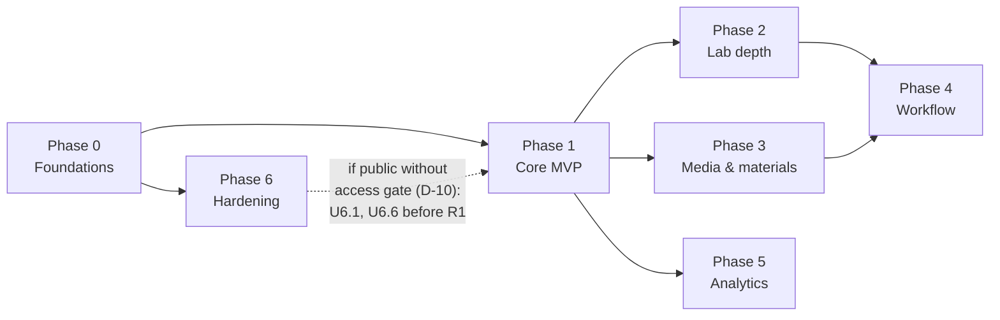

# Cucumber — Plant Lab App Roadmap

**Status:** Draft v1.1 · 2026-10-09 · Owner: Jade
**Inputs:** *Plant Inventory Features Overview* (Google Slides, the feature scope)
and [Plant Inventory V.3 SOP V.2](../../Plant%20Inventory%20V.3%20SOP%20V.2.md)
(the domain rules). Where they disagree, see [decisions.md](decisions.md).

**Names:** *Cucumber* is this app. *Anemone* is the separate TypeScript app that
sends receipts into Zoho Books (the deck uses "Anemone" for this app; ignore that).
**Locations:** `Lab` (old Lab + old Nursery) and `Nursery` (old Land) — see D-14.
Where the SOP says "Nursery" or "Land", read it with this mapping.

No implementation starts until **U0.1** (decisions & stack) passes G0.

## How this roadmap works

| Concept | Meaning |
|---|---|
| **Phase** | A group of units that ships together behind a release gate (R0–R6). |
| **Unit** (`Ux.y`) | Smallest piece of work that is specified, tested, reviewed and released on its own. 52 units total. |
| **Gate** (G0–G6) | Checkpoint every unit must pass in order: Spec → Design → Tests First → Build → Review → Verify → Release. Defined in [gates.md](gates.md). |
| **Release gate** (R0–R6) | Extra phase-level criteria checked once all units in the phase are at G6. |
| **Decision** (`D-nn`, `T-n`) | Open question that blocks specific units. Listed in [decisions.md](decisions.md). |
| **Size** | S ≈ days · M ≈ 1 week · L ≈ 2+ weeks (split at G0 if bigger). |

Progress for every unit × gate is tracked in [tracker.md](tracker.md).

## Non-negotiable principles (from SOP §2)

Every unit's G1 design is checked against these:

1. App, not spreadsheet — no Forms / Sheets in the data path.
2. No money in the app — costs stay in Zoho Books; only a reference is stored.
3. A plant record is not an SKU — SKU only on promotion to Portfolio.
4. Batch is the tracking unit — lineage via `parent_batch_id`.
5. Events are append-only — fix mistakes with `Correction` events.
6. Availability is calculated, never typed.
7. Enter once — dropdowns for coded fields; date and week automatic (date may be moved back up to 7 days).

## Phases

| Phase | Theme | Units | Deck section | Release gate |
|---|---|---|---|---|
| [0](phase-0-foundations.md) | Foundations | U0.1–U0.11 | 05 (part), 03 audit | R0 Platform ready |
| [1](phase-1-core-inventory.md) | Core inventory **MVP** | U1.1–U1.10 | 01 (part) + SOP-1…8 | R1 Go-live, Sheets retired |
| [2](phase-2-lab-depth.md) | Lab depth | U2.1–U2.6 | 01 | R2 |
| [3](phase-3-media-materials.md) | Media, materials & locations | U3.1–U3.5 | 02 | R3 |
| [4](phase-4-workflow.md) | Workflow & documentation | U4.1–U4.8 | 03 | R4 |
| [5](phase-5-analytics.md) | Analytics & monitoring | U5.1–U5.6 | 04 + SOP §8 | R5 |
| [6](phase-6-hardening.md) | Infrastructure & security | U6.1–U6.6 | 05 | R6 |

## Sequencing

- **Critical path to MVP:** U0.1 → U0.2a → U0.2b → U0.7 → U1.1 → U1.3 → U1.4 → U1.5 / U1.6 → U1.10 → R1.
- **Parallel after R1:** Phases 2, 3 and 5 can run side by side. Phase 4 needs
  U2.2, U2.4, U3.3 and U3.4 first.
- **Phase 6** units can start any time after R0; U6.3 and U6.5 wait for the data units.

Release notes and version numbers: see [release-process.md](release-process.md).

## Phase release gates

A phase passes its release gate when **all its units are at G6** *and*:

| Gate | Extra criteria |
|---|---|
| **R0 · Platform ready** | Phase-0 decisions Resolved · CI blocks merges below 80 % coverage · staging + production deployed · restore drill passed · permission matrix tested for all 4 roles |
| **R1 · MVP go-live** | V.2 migration reconciliation signed by Owner · **1-week parallel run** (V.2 and V.3 totals match) · staff trained on staging · V.2 sheets set read-only · Cloudflare Access gate in place (D-10); if public **without** an access gate, U6.1 + U6.6 released · full E2E suite green |
| **R2 · Lab depth** | Lineage tree verified on migrated data · subculture alerts match lab reality for 2 weeks |
| **R3 · Media & materials** | Every active media code has a template · traceability demo: plant batch → media lot → chemical lot |
| **R4 · Workflow** | One full protocol run end to end, started from a QR scan · labels printed for all active batches |
| **R5 · Analytics** | Metrics reproduce V.2 baselines · Owner uses the dashboard for one weekly review |
| **R6 · Hardening** | Whole-app security review, no CRITICAL / HIGH · restore drill from an **encrypted** backup · new staff trained only in sandbox |

## Coverage check: deck → units

| Deck feature | Unit(s) |
|---|---|
| Mother Plant Inventory | U1.1, U1.2, U2.4, U5.5 |
| Tissue Culture Lines | U1.3, U1.4, U2.1, U2.2 |
| Lineage Trees | U2.3 |
| Subculture & Branching | U1.5 |
| Acclimatization | U2.5 |
| Media Formulations | U3.4, U3.5 |
| Materials & Inventory | U3.3 |
| Storage Locations | U0.9, U3.1 |
| Supplier Contacts | U3.2 |
| Protocol Execution Runner | U4.3, U4.4 |
| Tasks & Scheduling | U4.1, U4.2 |
| QR Code Labels & Scanning | U4.5, U4.6 |
| Audit Trail & Record Keeping | U0.7 |
| Document Management | U4.7 |
| Culture labels after events (Owner request) | U4.8 |
| Dashboard & Analytics | U5.1, U5.3 |
| Report Builder | U5.4 |
| Environmental Telemetry | U5.6 |
| GPS Mapping | U5.5 |
| Role Access Control | U0.5, U0.6, U6.1 |
| Encrypted Backups | U0.11, U6.2, U6.3 |
| Customization | U0.9, U6.4 |
| Sandbox Mode | U6.5 |

| SOP procedure / section | Unit(s) |
|---|---|
| SOP-1 Register a plant | U1.1 |
| SOP-2 Promote to Portfolio | U1.2 |
| SOP-3 Start a lab batch | U1.3, U1.4 |
| SOP-4 Subculture | U1.5 |
| SOP-5 Stage change / transfer | U1.6 |
| SOP-6 Collection count | U1.7 |
| SOP-7 Review | U1.8 |
| SOP-8 Zoho link | U1.9 |
| SOP-11 Record a loss | U1.4 |
| §8 Availability & metrics | U5.1, U5.2 |
| Migration from V.2 | U1.10 |
