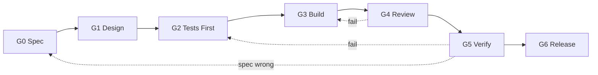

# Gates — Definition of Done per Unit

Every unit of work (`Ux.y`) passes the same seven gates, in order. A unit
cannot enter a gate until the previous gate is signed off. Gate IDs are written
`U1.4/G2`.

## G0 · Spec

**Purpose:** agree on *what* the unit does before anyone designs it.

| Exit criterion | Evidence |
|---|---|
| User stories written (who / what / why) | Unit spec file |
| Acceptance criteria in Given / When / Then form, one per behaviour | Unit spec file |
| SOP rules and deck features it implements are cited (e.g. "SOP §5 rule 5") | Unit spec file |
| Out-of-scope list written | Unit spec file |
| Every blocking decision in [decisions.md](decisions.md) is **Resolved** | Decision register |
| Size confirmed (S / M / L); L units split if they exceed one build cycle | Tracker |

**Sign-off:** Owner.

## G1 · Design

**Purpose:** decide *how* before writing code.

| Exit criterion | Evidence |
|---|---|
| Data model changes + migration script plan (forward **and** rollback) | Design note |
| API contract (endpoints, request / response envelope, error codes) | Design note |
| UI wireframe for **mobile and desktop** | Sketch / Figma link |
| Permission matrix rows added for every new action | [Roles matrix](phase-0-foundations.md#u06--roles--permissions) |
| Audit events listed: what gets written to the audit trail | Design note |
| Validation rules and error messages listed | Design note |
| No conflict with the fixed principles (SOP §2) | Reviewer checklist |
| Business rules and permission checks live in services; views are thin; templates only decide what is shown ([ADR-0001](adr/0001-stack-selection.md#architecture-rule-thin-views-rules-in-services)) | Design note |

**Sign-off:** Owner + architect review.

## G2 · Tests First (RED)

**Purpose:** encode the acceptance criteria as executable tests before
implementation.

| Exit criterion | Evidence |
|---|---|
| ≥ 1 test per acceptance criterion | Test files |
| Unit tests for domain rules (calculations, guards, ID formats) | Test files |
| Integration tests for every endpoint and DB constraint | Test files |
| E2E test for every critical user flow the unit touches | Test files |
| Test fixtures / seed data committed | Fixture files |
| CI run shows the new tests **failing** for the right reason | CI run link |

**Sign-off:** Developer + reviewer.

## G3 · Build (GREEN → IMPROVE)

**Purpose:** implement until tests pass, then refactor.

| Exit criterion | Evidence |
|---|---|
| All tests green in CI | CI run link |
| Coverage ≥ 80 % on the unit's code | Coverage report |
| Lint + type check clean | CI run link |
| Functions < 50 lines, files < 800 lines, nesting ≤ 4 levels | Lint / review |
| No hard-coded secrets, no debug statements | Lint / review |
| Immutable data patterns; events never mutated | Review |

**Sign-off:** Developer.

## G4 · Review

**Purpose:** independent quality and security check.

| Exit criterion | Evidence |
|---|---|
| Code review done, **no CRITICAL or HIGH** findings open | Review log |
| Security review done if the unit touches auth, user input, DB queries, files, external APIs, or crypto | Review log |
| MEDIUM findings fixed or logged as follow-ups | Review log |
| Migration reviewed for data loss risk | Review log |

**Sign-off:** Reviewer. Failure → back to **G3**.

## G5 · Verify

**Purpose:** prove it works for real users on realistic data.

| Exit criterion | Evidence |
|---|---|
| Deployed to **staging** with sandbox data | Deploy log |
| Full E2E suite passes on staging (not only the new tests) | CI run link |
| Owner UAT: walks through the matching SOP procedure end to end | UAT note |
| Staff UAT for any data-entry screen (phone in hand, in the lab) | UAT note |
| Works on phone width and desktop | Screenshots |
| Performance acceptable at 10× current data volume | Timing note |

**Sign-off:** Owner. Behaviour wrong → back to **G2**. Spec wrong → back to **G0**.

## G6 · Release

**Purpose:** ship safely and leave it documented.

| Exit criterion | Evidence |
|---|---|
| Verified backup taken immediately before release | Backup log |
| Migration run on production; rollback rehearsed on staging | Release log |
| Feature switched on (flag) and smoke-tested in production | Release log |
| SOP / user guide updated for any changed procedure | Docs diff |
| Staff told what changed | Published GitHub Release with a staff note, sent to the staff LINE group ([release process](release-process.md)) |

**Sign-off:** Owner.

## Rules

1. **Dependencies:** a unit may enter **G3** only when every dependency has
   passed **G4**. It may enter **G6** only when every dependency has passed **G6**.
2. **Decisions:** a blocking decision must be Resolved before the unit exits **G0**.
3. **Failure:** a failed gate returns the unit to the gate named above, and the
   failure is recorded in the gate log ([tracker.md](tracker.md#gate-log)).
4. **No skipping.** Small units still pass every gate; the evidence is just shorter.
5. **Phase release gates** (R0–R6, see [README](README.md#phase-release-gates))
   apply *on top of* unit gates.
