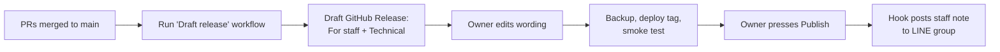

# Release notes process

**Status:** Agreed by the Owner 2026-10-11 · built in U0.3 (repo side) and
U0.4 (deploy side) · first used at the first production deploy (R0).

Every release produces **one GitHub Release** holding two kinds of notes:

| Part | Reader | Written by | Sent to |
|---|---|---|---|
| **For staff** | Everyone who uses Cucumber | A person, in plain words | Staff LINE group, automatically |
| **Technical changes** | Owner, developers, Claude | Generated from commit messages (git-cliff) | Stays on GitHub and in `CHANGELOG.md` |

The published GitHub Release is the evidence for the G6 line "Staff told what
changed".

## Decisions

| Topic | Choice |
|---|---|
| Version numbers | **By date: `YYYY.MM.N`**, e.g. `2026.11.1`, `2026.11.2`. `N` restarts at 1 each month. The Git tag has the same name. |
| How often | **When ready, at most once a week**, outside busy lab hours. An urgent fix can go any time with a short note. |
| Language | **English now, Thai later**, switching when the app gets Thai (D-16). |
| How staff hear | **GitHub plus a hook:** publishing the GitHub Release sends the staff note to the staff LINE group. Staff don't need GitHub accounts. |

Docs-only changes (like the roadmap) don't get a release.

## Where the notes come from

1. **Commit messages** already follow `type: description` (`feat`, `fix`,
   `perf`, `refactor`, `docs`, `test`, `chore`, `ci`). git-cliff groups them:

   | Commit type | Technical changelog section |
   |---|---|
   | `feat` | Added |
   | `fix` | Fixed |
   | `perf` | Faster |
   | `refactor`, `docs`, `test`, `chore`, `ci` | Not listed (internal) |

2. **Every pull request has a "Staff note"** ([template](../../.github/pull_request_template.md)):
   one or two plain sentences on what staff will notice, who is affected, and
   any changed procedure (with the SOP section). Write "None" if staff won't
   notice anything. The release collects these notes, so nobody has to remember
   them later.

## Release steps



1. **Draft.** Run the *Draft release* GitHub workflow. It works out the next
   version number, runs git-cliff for the technical part, gathers the Staff
   notes from pull requests merged since the last release, and creates a
   **draft** GitHub Release. Drafts are visible only to the repo owner.
2. **Edit.** The Owner reads the draft and fixes the staff wording. Keep it
   short; the template is below.
3. **Ship.** Take the verified backup, deploy the tag to the server, run the
   smoke test (G6). If anything fails, the draft stays a draft and nothing is
   announced.
4. **Publish.** Pressing *Publish* on GitHub means "it's live". The
   `release: published` hook sends the **For staff** part to the staff LINE
   group, and the release becomes the permanent record.

## Staff note template

```text
Cucumber 2026.11.1 is live

New
- You can now split a batch for a pre-order (Split button on the batch page).

Changed in how you work
- Losses now need a reason. See SOP §6.4.

Fixed
- The date picker no longer jumps to next month.

Questions? Ask Jade.
```

Leave out sections that are empty. No technical words, no commit hashes, no
prices or costs (SOP §2 principle 2).

## The LINE hook

- **Account:** LINE Notify closed on 31 March 2025, so the hook uses a free
  **LINE Official Account** and LINE's **Messaging API**. The Owner creates
  the account and adds it to the staff group. The free plan includes a monthly
  message allowance; a group message counts once per member, which is plenty
  for one release a week to a small team. Check the current allowance when
  setting up.
- **Secrets:** the channel access token and group ID are stored as **GitHub
  Actions secrets** by the Owner, never in the repo or in chat.
- **No third-party action:** the workflow calls LINE's API directly with one
  `curl` request. Nothing outside GitHub and LINE sees the token.
- **If LINE fails**, the release is still published. The workflow run shows a
  red mark, and the Owner posts the note by hand.

## Who builds what

| Piece | Unit |
|---|---|
| Pull request template with "Staff note" | Now (this change) |
| git-cliff config, `CHANGELOG.md`, *Draft release* workflow | U0.3 |
| Deploy from a tag, smoke test, `release: published` LINE hook | U0.4 |
| LINE Official Account, adding it to the staff group, GitHub secrets | Owner, before the first release (R0) |
| Optional in-app "What's new" page | Later; revisit after R1 |
