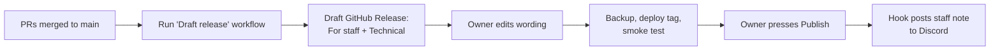

# Release notes process

**Status:** Agreed by the Owner 2026-10-11 · built in U0.3 (repo side) and
U0.4 (deploy side) · first used at the first production deploy (R0).

Every release produces **one GitHub Release** holding two kinds of notes:

| Part | Reader | Written by | Sent to |
|---|---|---|---|
| **For staff** | Everyone who uses Cucumber | A person, in plain words | Staff Discord channel, automatically |
| **Technical changes** | Owner, developers, Claude | Generated from commit messages (git-cliff) | Stays on GitHub; the list of GitHub Releases is the changelog (no `CHANGELOG.md` file, U0.3 design §7) |

The published GitHub Release is the evidence for the G6 line "Staff told what
changed".

## Decisions

| Topic | Choice |
|---|---|
| Version numbers | **By date: `YYYY.MM.N`**, e.g. `2026.11.1`, `2026.11.2`. `N` restarts at 1 each month. The Git tag has the same name. |
| How often | **When ready, at most once a week**, outside busy lab hours. An urgent fix can go any time with a short note. |
| Language | **English now, Thai later**, switching when the app gets Thai (D-16). |
| How staff hear | **GitHub plus a hook:** publishing the GitHub Release sends the staff note to the staff Discord channel. Staff don't need GitHub accounts. |

Docs-only changes (like the roadmap) don't get a release.

## Where the notes come from

1. **Commit messages** already follow `type: description` (`feat`, `fix`,
   `perf`, `refactor`, `docs`, `test`, `chore`, `ci`). git-cliff groups them:

   | Commit type | Technical changelog section |
   |---|---|
   | `feat` | Added |
   | `fix` | Fixed |
   | `perf` | Faster |
   | `refactor`, `docs`, `test`, `chore`, `ci` | Not listed (internal) |

2. **Every pull request has a "Staff note"** ([template](../../.github/pull_request_template.md)):
   one or two plain sentences on what staff will notice, who is affected, and
   any changed procedure (with the SOP section). Write "None" if staff won't
   notice anything. The release collects these notes, so nobody has to remember
   them later.

## Release steps



1. **Draft.** Run the *Draft release* GitHub workflow. It notes the current
   `main` commit, works out the next version number, runs git-cliff for the
   technical part, gathers the Staff notes from exactly the pull requests in
   that range, **creates the version tag at that commit**, and creates a
   **draft** GitHub Release for it. Drafts are visible only to the repo owner.
   To abandon a draft, delete it together with its tag
   (`gh release delete <version> --cleanup-tag`).
2. **Edit.** The Owner reads the draft and fixes the staff wording. Keep it
   short; the template is below.
3. **Ship.** Take the verified backup, deploy **that tag** to the server (so
   what runs is exactly what the notes describe), run the smoke test (G6). If anything fails, the draft stays a draft and nothing is
   announced.
4. **Publish.** Pressing *Publish* on GitHub means "it's live". The
   `release: published` hook sends the **For staff** part to the staff
   Discord channel, and the release becomes the permanent record.

## Staff note template

```text
Cucumber 2026.11.1 is live

New
- You can now split a batch for a pre-order (Split button on the batch page).

Changed in how you work
- Losses now need a reason. See SOP §6.4.

Fixed
- The date picker no longer jumps to next month.

Questions? Ask Jade.
```

Leave out sections that are empty. No technical words, no commit hashes, no
prices or costs (SOP §2 principle 2).

## The Discord hook

- **Webhook:** in the staff Discord server, the Owner creates a webhook for the
  announcements channel (*Channel settings → Integrations → Webhooks*). It's
  free and needs no bot or extra account.
- **Secret:** the webhook address works like a password: anyone who has it can
  post to the channel. The Owner stores it as a **GitHub Actions secret**
  (`DISCORD_RELEASE_WEBHOOK`), never in the repo or in chat. If it ever leaks,
  delete the webhook in Discord and make a new one.
- **No third-party action:** the workflow posts to Discord directly with one
  `curl` request, with `allowed_mentions: {"parse": []}` so a note containing
  `@everyone` or a name can't ping people.
- **Length:** a Discord message holds up to 2,000 characters. A staff note
  should be far shorter; if it isn't, the hook posts the first part with a link
  to the full GitHub Release.
- **If Discord fails**, the release is still published. The workflow run shows a
  red mark, and the Owner posts the note by hand.

## Who builds what

| Piece | Unit |
|---|---|
| Pull request template with "Staff note" | Now (this change) |
| git-cliff config, *Draft release* workflow | U0.3 |
| Deploy from a tag, smoke test, `release: published` Discord hook | U0.4 |
| Discord webhook for the announcements channel, saved as a GitHub secret | Owner, before the first release (R0) |
| Optional in-app "What's new" page | Later; revisit after R1 |
