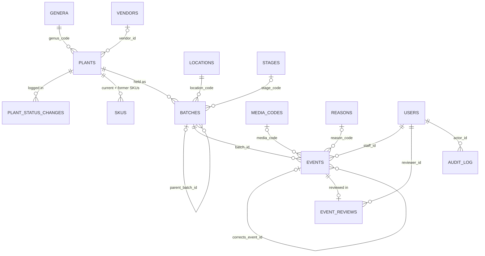

# U0.2 · Domain model v1 — Design note (G1)

**Spec:** [u0.2-spec.md](u0.2-spec.md) · **Status:** G1 draft · 2026-10-10
**Assumes** the recommended answers to spec questions Q5–Q8. Answered: Q1 static SKU with reclassification exception, Q2 Zoho link completed later with a Portfolio gate (§2.2), Q3 separate review table with Admin auto-review (§2.5), Q4 no `qty_contaminated` plus a `loss` action (§3, §3.2).
**Stack:** Django 5.2 + PostgreSQL ([ADR-0001](../adr/0001-stack-selection.md)).

## 1. How the model works

1. **Events are the truth.** Every change to a batch's count, stage or
   quarantine flag is an event. Events are never updated or deleted.
2. **Batches carry a projection.** `live_count`, `stage_code` and `quarantined`
   on `batches` are worked out from events, never typed. A service updates them
   **in the same transaction** as the event insert, with the batch row locked
   (`SELECT … FOR UPDATE`). The database then checks the result (for example
   `live_count >= 0`), so a bad event is rejected even if the service has a bug.
3. **Fixes are new rows.** Void, Correction and Review are new rows that point
   at the original event. Status changes on plants are logged in their own
   insert-only table.
4. **Codes, not lookup IDs.** Reference tables use their code as the primary key
   (`P0`, `lab`, `M001`, `PHL`). Codes can't change, so history stays readable
   and check constraints can name them.
5. **The Django admin is read-only** for plants, batches, events, reviews and
   vendors. All writes go through services (ADR-0001: the admin bypasses
   services). Rules that cross tables can then live in services; rules on a
   single row are always in the database as well.



## 2. Tables

Types are PostgreSQL. `id` columns are `bigint` identity. Display IDs
(`PLT-0042`, `BAT-00117`, `EVT-01502`) are formatted from `id` (detail in U0.8;
note that `lpad` **cuts off** numbers longer than the pad width, so the
formatter must not use plain `lpad`). **Labels:** a jar label identifies its
batch by `BAT-nnnnn` (and QR), because `PHL001 · B003` can change (promotion,
reclassification); other label text is printed as it was at print time
(U4.8, D-18). Stored choice values are lowercase
(`portfolio`, `lab`); screens show translated labels (D-16).

### 2.1 Reference lists

Items are deactivated, never deleted. Codes can't be renamed.

| Table | Columns | Constraints |
|---|---|---|
| `genera` | `code char(3)` PK, `name text`, `active bool` | code `~ '^[A-Z]{3}$'`; `name` unique |
| `stages` | `code text` PK, `label text`, `sort_order int` null, `default_subculture_days int` null, `active bool` | `sort_order` unique; `active → sort_order NOT NULL`; `default_subculture_days > 0` |
| `media_codes` | `code text` PK, `label text`, `active bool` | — |
| `locations` | `code text` PK, `label text`, `active bool` | — |
| `reasons` | `code text` PK, `label text`, `applies_to text` (`void` / `correction` / `loss`), `active bool` | `applies_to` in list |

**Seed data** (data migration):

| Table | Rows |
|---|---|
| `stages` | `P0` 1 · `P1` 2 · `P2` 3 · `A1` 4 · `P4` 5 (active); `P3`, `T1`, `C0` inactive, no sort order (reserved). Interval days left blank until U2.2. |
| `locations` | `lab` Lab · `nursery` Nursery (D-14) |
| `media_codes` | `M001`–`M004`, `G001`, `G002`, `R001` |
| `genera` | `HYA` Hoya · `PHL` Philodendron · `ALC` Alocasia (more added by the Admin) |
| `reasons` | Void: duplicate entry · wrong batch · wrong plant · test entry · other. Correction: wrong quantity · wrong media code · wrong stage · wrong date · other. Loss: failed acclimatization · pest · rot · damage · unknown · other |

### 2.2 `plants`

| Column | Type | Notes |
|---|---|---|
| `id` | bigint PK | shown as `PLT-nnnn` |
| `genus_code` | char(3) FK → `genera` | |
| `full_name` | text | |
| `sku` | text null FK → `skus` | unique; static once set (Q1) |
| `status` | text | `candidate` / `collection` / `portfolio` / `retired` / `voided` |
| `source` | text null | `purchase` / `gift` / `propagated` / `unknown` |
| `source_note` | text null | who gave a gift |
| `vendor_id` | text null FK → `vendors` | |
| `zoho_ref` | text null | Admin-only field; may be filled in after registration (Q2) |
| `min_saleable_qty` | int null | per-plant override (T-2) |
| `notes` | text | default `''` |
| `created_at`, `created_by` | timestamptz, FK → users | |

Check constraints:

```sql
status IN ('candidate','collection','portfolio','retired','voided')
status <> 'portfolio' OR sku IS NOT NULL                       -- rule 1, Q1
sku IS NULL OR sku ~ '^[A-Z]{3}[0-9]{3}$'
sku IS NULL OR left(sku, 3) = genus_code                       -- rule 1
status = 'candidate' OR source IS NOT NULL
status <> 'portfolio' OR source <> 'purchase'                  -- rule 4, Q2:
    OR (vendor_id IS NOT NULL AND zoho_ref IS NOT NULL)        --   no Portfolio without a full Zoho link
source = 'purchase' OR (vendor_id IS NULL AND zoho_ref IS NULL)
min_saleable_qty IS NULL OR min_saleable_qty >= 1
```

Unique index on `(genus_code, lower(full_name)) WHERE status <> 'voided'` (Q6).

**Zoho link (Q2).** A purchased plant may be registered without a vendor or
`zoho_ref`; when no vendor is listed, the seller's name goes in `source_note`.
"Zoho link missing" = `source = 'purchase' AND (vendor_id IS NULL OR zoho_ref
IS NULL) AND status <> 'voided'`, shown to the Admin. The check above blocks
promotion to Portfolio until the link is complete. Tech can read vendor names;
`zoho_ref` is Admin-only (enforced in services, U1.9).

**Static SKU (Q1).** `plants.sku` is a foreign key to **`skus`**, an
insert-only register of every SKU ever issued: `sku` PK, `plant_id`,
`genus_code`, `assigned_at`, `assigned_by`, with the check
`left(sku, 3) = genus_code`. Because the register is insert-only and keyed on
`sku`, an SKU can never be issued twice, even after a plant is retired, voided
or reclassified. The per-genus sequence (U0.8) counts from this table.

A trigger on `plants` enforces that the SKU doesn't change:

- once `sku` is set, it can't go back to null;
- it can change **only** in the same update that changes `genus_code`
  (reclassification), and the new SKU's prefix must match the new genus (the
  check above).

Reclassification (Admin only) is one service call: change the genus, issue the
next SKU for the new genus into `skus`, point the plant at it, and log a
`plant_status_changes` row with reason "genus reclassified". The plant's
**former SKUs** are its rows in `skus` other than the current one; plant search
matches them as well. A plant with no SKU can change genus without any of this.

`promoted_by` / `promoted_at` from SOP §4 move to **`plant_status_changes`**
(insert-only): `id`, `plant_id`, `from_status`, `to_status`, `sku_assigned`
(null), `changed_by`, `changed_at`, `reason` (null). The latest row gives
"promoted by / at", and every earlier change stays visible.

### 2.3 `batches`

| Column | Type | Notes |
|---|---|---|
| `id` | bigint PK | shown as `BAT-nnnnn` |
| `plant_id` | FK → `plants` | |
| `plant_seq` | int | the `Bnnn` in `PHL001 · B003`; unique per plant (U0.8) |
| `parent_batch_id` | bigint null | FK `(parent_batch_id, plant_id)` → `batches (id, plant_id)` |
| `origin` | text | `intake` / `subculture` / `quarantine` / `transfer` |
| `location_code` | FK → `locations` | |
| `stage_code` | FK → `stages`, null | projection: latest stage |
| `quarantined` | bool | projection |
| `status` | text | `open` / `closed` / `voided` |
| `live_count` | int | projection: sum of effective events |
| `created_at`, `created_by` | | |
| `closed_at`, `voided_at` | timestamptz null | |

Check constraints:

```sql
origin = 'intake' OR parent_batch_id IS NOT NULL               -- rule 5
parent_batch_id IS NULL OR parent_batch_id <> id
location_code <> 'lab' OR stage_code IS NOT NULL               -- rule 6
live_count >= 0                                                -- rule 7
status = 'open' OR live_count = 0                              -- rule 9, Q7
(status = 'closed') = (closed_at IS NOT NULL)
(status = 'voided') = (voided_at IS NOT NULL)
NOT quarantined OR origin = 'quarantine'                       -- D-02
```

- The composite foreign key keeps lineage inside one plant: a child batch can't
  point at another plant's batch. Cycles can't happen, because a parent must
  exist before its child and `parent_batch_id` never changes.
- Standing batch (SOP §4): unique index on `(plant_id, location_code)
  WHERE location_code <> 'lab' AND status = 'open' AND NOT quarantined`.
- Rule 6 names `lab` in the check. A future location that also needs a stage
  means a migration; acceptable for a two-location business.

### 2.4 `events`

| Column | Type | Notes |
|---|---|---|
| `id` | bigint PK | shown as `EVT-nnnnn` |
| `operation_id` | uuid | same value for every event made by one user action (Q8) |
| `batch_id` | FK → `batches` | |
| `action` | text | see §3 |
| `qty_in`, `qty_out` | int, default 0 | |
| `counted_qty` | int null | `count` only |
| `media_code` | FK → `media_codes`, null | |
| `stage_to` | FK → `stages`, null | |
| `staff_id` | FK → users | who did it |
| `occurred_at` | timestamptz | when it happened (Q5) |
| `recorded_at` | timestamptz, default `now()` | when it was saved |
| `reason_code` | FK → `reasons`, null | |
| `voids_event_id` | bigint null | FK `(voids_event_id, batch_id)` → `events (id, batch_id)` |
| `corrects_event_id` | bigint null | FK `(corrects_event_id, batch_id)` → `events (id, batch_id)` |
| `note` | text, default `''` | |

`qty_contaminated` is dropped (Q4); `media_lot` arrives with U3.5; `week` is
not stored. It is the ISO week of `occurred_at` in Asia/Bangkok, worked out
in reports.

Check constraints (beyond the per-action ones in §3):

```sql
qty_in >= 0 AND qty_out >= 0                                   -- rule 7
NOT (qty_in > 0 AND qty_out > 0)
counted_qty IS NULL OR counted_qty >= 0
(action = 'void')       = (voids_event_id IS NOT NULL)
(action = 'correction') = (corrects_event_id IS NOT NULL)
action NOT IN ('void','correction','loss')                     -- rule 8, Q4
    OR reason_code IS NOT NULL
occurred_at <= recorded_at + interval '5 minutes'              -- Q5: never in the future
occurred_at >= recorded_at - interval '7 days'                 -- Q5: at most 7 days back
```

Unique index on `voids_event_id` (an event is voided once). The composite
foreign keys keep a void or correction on the same batch as the event it fixes.

### 2.5 `event_reviews` (Q3)

`id`, `event_id` FK → `events` **unique**, `reviewer_id` FK → users,
`reviewed_at` default `now()`, `note`. Insert-only (same trigger as `events`).
In Django: a `OneToOneField` from the review to the event.

- A review only says "checked"; a fix is a separate Correction or Void event,
  which enters the queue itself.
- **Queue** = events with no review row, excluding events that have been voided.
  Reviewing a Void covers the event it voided.
- **Who reviews what** (service guard): Tech events → Supervisor or Admin;
  Supervisor events → Admin only; every Void (including Undo) → Admin only.
- **Admin auto-review:** when the Admin logs an event, the same service call
  writes its review row (reviewer = Admin, note "Admin, own entry").
- **Fix marks reviewed:** when a reviewer adds a Correction or Void to an
  unreviewed event, the original gets its review row in the same transaction.
- A review can't be undone; a wrong review is fixed with a Correction or Void.
- Every screen that shows review status loads events through one helper
  (`Event.objects.with_review()`); a query-count test on list pages catches a
  missed join.

### 2.6 `vendors` (D-04)

`zoho_contact_id text` PK, `name`, `active`, `synced_at`. Written only by the
Zoho sync job (U3.2); deactivated, never deleted, when gone from Zoho.

### 2.7 Users and audit

- **Users:** Django's `auth_user`; role is a Django group (`admin`,
  `supervisor`, `tech`, `read_only`, U0.6). Events point at users with
  `on_delete=PROTECT`. PDPA anonymisation overwrites name, username and email
  on the user row; the row and its events stay.
- **`audit_log`** (insert-only; mechanism in U0.7): `id`, `actor_id`, `at`,
  `table_name`, `row_pk`, `action`, `before jsonb`, `after jsonb`, `reason`.
  Written for every insert or update to plants, batches, reference lists and
  vendors. Events and reviews don't need audit rows: they are their own record.

## 3. Event shapes

| Action | On batch | `qty_in` | `qty_out` | Also required | Projection change |
|---|---|:-:|:-:|---|---|
| `intake` | new or existing | > 0 | 0 | `stage_to` (starting stage) at Lab; `media_code` at Lab stages P0–A1 | count + in; stage set |
| `subculture` | parent | 0 | > 0 | `media_code`; one `intake` per child batch, same `operation_id` | count − out |
| `stage_change` | any | 0 | 0 | `stage_to` | stage = `stage_to` |
| `count` | any | diff | diff | `counted_qty`; service writes the difference from `live_count` | count = `counted_qty` |
| `contamination` | any | 0 | > 0 | — | count − out |
| `quarantine` | parent | 0 | > 0 | one `intake` on the new quarantined child, same `operation_id` | count − out |
| `release` | quarantined child | 0 | 0 | — | `quarantined` = false |
| `transfer` | source / destination | one of in / out > 0 | | pair of events, same `operation_id` | ± count |
| `out` | any | 0 | > 0 | — | count − out |
| `loss` | any | 0 | > 0 | `reason_code` (loss list): death or damage that isn't contamination (Q4) | count − out |
| `correction` | same as original | new values | | `corrects_event_id`, `reason_code` | difference applied |
| `void` | same as original | 0 | 0 | `voids_event_id`, `reason_code` | original's effect removed |

Per-action checks in the database: `intake` needs `qty_in > 0`;
`subculture`, `contamination`, `quarantine`, `out`, `loss` need `qty_out > 0` and
`qty_in = 0`; `stage_change` needs `stage_to`; `count` needs `counted_qty`;
`stage_change`, `release`, `void` need both quantities = 0; `transfer` needs
`qty_in + qty_out > 0`. Rules that depend on the batch (Lab needs a starting
stage and media) are service guards, because a check constraint can only see
its own row. The reason's `applies_to` matching the action (a loss reason on a
`loss`) is also a service guard.

### 3.1 Void, Correction, Undo

- **Void** points at the original. The original no longer counts toward
  `live_count`, stage or metrics. Voids can't be voided (log the action again
  instead). Voiding one event of an operation voids **all** of its events
  together; refused if any batch created by it has later events (Q8).
- **Correction** restates the original's correctable values (`qty_in`,
  `qty_out`, `counted_qty`, `media_code`, `stage_to`, `occurred_at`). The
  newest non-voided correction wins. A correction can't change the action or
  the batch; that is a Void plus a new event. Corrections point at the
  original, never at another correction.
- **Undo** is a Void by the event's own `staff_id` within 10 minutes of
  `recorded_at`. Reason defaults to "entered in error". It goes to the review
  queue like every void (rule 10).
- A database view **`effective_events`** applies voids and corrections, so
  reports and the projection rebuild read one place.

### 3.2 Contamination and loss (Q4)

There is no `qty_contaminated` column. Contaminated units are recorded once, as
events:

- **Thrown away** → `contamination`. **Kept** → `quarantine` (moved to a
  quarantined child batch). **Died for another reason** → `loss` with a reason.
- **One form, separate operations.** The Subculture form has optional
  "contaminated, thrown away" and "contaminated, kept" fields (U1.5). Saving
  writes the subculture, the contamination and the quarantine as **separate
  operations**, so each can be voided or corrected on its own.
- **Credit goes to the batch's maker.** Contamination metrics take media, staff
  and week from the `intake` that created the batch, not from whoever logged
  the contamination.
- **No double counting.** Contamination rate counts every `quarantine`, plus
  `contamination` on batches **not under quarantine at the time** (no
  `release` yet on a quarantine batch). A quarantined jar that is later lost is
  counted once.
- **Released jars still count.** A jar was contaminated when found; rescuing it
  doesn't change that (SOP §8 includes quarantined units).
- `loss` is never in the contamination rate. It feeds survival metrics (A1 → P4)
  and loss-by-reason. A short `count` stays an *unexplained* difference.

### 3.3 Keeping the projection honest

- Every event write goes through one service function per action. It locks the
  batch row, checks the batch is open, inserts the event(s), and updates the
  projection, all in one transaction. The `live_count >= 0` check rejects the
  whole transaction if it would go negative (rule 7, AC17).
- A management command `check_projections` recalculates every batch from
  `effective_events` and reports any difference. It runs in CI against
  fixtures, and nightly in production.
- *Option considered:* keep the projection with database triggers instead of
  services. Rule 7 would then hold even for raw SQL inserts, but the logic would
  be in SQL rather than Python, which is harder for the Owner to read. Not
  chosen, because the admin is read-only and the app's DB user is the only
  writer. Revisit if a second writer (API, import job) appears.

## 4. Database-level protection

| Protection | Applies to | How |
|---|---|---|
| No UPDATE / DELETE / TRUNCATE | `events`, `event_reviews`, `plant_status_changes`, `skus`, `audit_log` | `BEFORE UPDATE OR DELETE` and `BEFORE TRUNCATE` triggers that raise; also not granted to the app user |
| No DELETE / TRUNCATE | `plants`, `batches`, reference tables, `vendors` | trigger + not granted |
| Codes can't be renamed | reference tables | trigger raises if `code` changes; FKs use the default `NO ACTION` |
| SKU static | `plants` | trigger: `sku` never cleared; changes only together with `genus_code` (Q1) |
| Two DB users | all | `cucumber_owner` runs migrations; `cucumber_app` runs the app with SELECT / INSERT, plus UPDATE only where allowed above |

The triggers stop the table owner too (AC13). Turning a trigger off is a
deliberate, logged Admin step in a maintenance window. That is how the PDPA
exception would be handled if staff data ever reached a protected table;
today it only lives in `auth_user`, which isn't protected. The sandbox (U6.5) is
a separate database, so wiping it needs no exception.

## 5. Rule-to-enforcement table (AC1)

**DB** = database constraint or trigger · **Svc** = service guard · **Why not DB** = written reason.

| SOP §5 rule | DB | Svc | Why not (fully) in DB |
|---|---|---|---|
| 1 SKU assigned on first promotion, static, never reused, genus matches | `portfolio → sku`; `skus` register (PK = never reused, insert-only); format; prefix = genus on `plants` and `skus`; static-SKU trigger | Promote reuses an existing SKU, else proposes the next for the genus (U0.8); reclassification issues a new SKU; search includes former SKUs; Admin only | — |
| 2 Only Admin promotes / demotes / retires; stamped; Candidate → Collection on first Intake | `plant_status_changes` insert-only | Role check; status transition map; auto-change on first intake | Roles live in the app, not the database |
| 3 Candidate has no batches or events | — | Refuse batch creation for a `candidate` plant; refuse moving back to `candidate` once batches exist | Needs the plant's status while inserting a batch (cross-table). Admin is read-only, so the service is the only path |
| 4 Purchase needs `zoho_ref` + vendor; vendors only from Zoho | Portfolio + purchase → vendor and `zoho_ref`; FK to `vendors`; non-purchase has no vendor or ref | "Zoho link missing" list; Admin completes vendor and `zoho_ref`; `zoho_ref` Admin-only | Q2: the expense or vendor may not be in Zoho at registration, so the DB requires the link before selling, not at intake. `vendors` written only by the sync job |
| 5 Subculture batch has a parent | `origin <> 'intake' → parent`; same-plant composite FK; no self-parent | Service creates children with parent set | — |
| 6 Every Lab batch has a stage | `location_code <> 'lab' OR stage_code IS NOT NULL` | Lab intake requires `stage_to` | — |
| 7 `live_count` never negative | `live_count >= 0`; quantities ≥ 0 | Row lock + projection update in one transaction | Projection depends on the service updating it; `check_projections` catches drift |
| 8 Events can't be edited or deleted; Void / Correction with reason; Undo 10 min | Triggers + grants; reason required; one void per event; same-batch FKs | Undo: own event, ≤ 10 min from `recorded_at`; operation-wide void (Q8) | "Own event within 10 minutes" needs the current user |
| 9 Plants and batches never hard-deleted; Voided / Retired / Closed | DELETE triggers + grants; status lists; `closed_at` / `voided_at` match status; closed / voided needs `live_count = 0` | Retire only when all batches are closed or voided; void a batch only after its events are voided | Cross-table |
| 10 Unreviewed events count but are flagged; nobody reviews own (except Admin); voids reviewed | One review per event; reviews insert-only | Reviewer ≠ `staff_id` unless Admin; Supervisor events and all Voids need the Admin; Admin events auto-reviewed; queue = unreviewed, non-voided events | Needs roles |
| 11 Quarantined batch excluded from availability | `quarantined → origin = 'quarantine'` | Availability query filters `NOT quarantined` (U5.2) | It is a calculation, not stored data (principle 6) |
| 12 `PHL005` stays valid until identified | — | — | Nothing to enforce: `full_name` is free text; Q6 asks for a distinct placeholder name |

**Also enforced (SOP §2 / §3):** append-only plant history (principle 5) ·
availability never typed (no column exists, principle 6) · stage sort order
unique (D-06, AC21) · reference codes immutable (AC20) · events only on open
batches (Svc, under the row lock).

## 6. Migration plan

- **Forward:** Django migrations. `CheckConstraint` and `UniqueConstraint`
  (with `condition=`) are written in the models; triggers, grants and the
  `effective_events` view use `RunSQL` with a `reverse_sql`. A data migration
  seeds §2.1.
- **Rollback:** every migration reverses cleanly while there is no real data
  (until R1). After go-live, schema changes are forward-only (add first,
  remove later), and rollback is rehearsed on staging (G6).
- **G2 tests** (from the spec ACs): one test per check, unique index, FK and
  trigger, run against real PostgreSQL (not SQLite); a raw-SQL UPDATE / DELETE
  attempt on each protected table; a two-connection race for AC17.

## 7. G1 checklist

| Item | Answer |
|---|---|
| Data model + migration plan | §2, §6 |
| API contract | None; no API in this stack (ADR-0001). Service function list comes with U0.7 / U1.x |
| UI wireframe | Not applicable; no screens in this unit |
| Permission matrix rows | None new. Review rule (D-03) already in U0.6 |
| Audit events | §2.7 |
| Validation rules and messages | §2 checks. Database errors are mapped to user messages in services (U1.x) |
| SOP §2 principles | 3 (SKU only on promotion), 4 (batch grain), 5 (append-only), 6 (no availability column), 2 (only `zoho_ref`, no amounts) |
| Rules in services, thin views | §1 point 5, §3.3 |
